# Box Insert Studio

Free web application hosted on GitHub Pages which you can use to design a board game insert constructed from glued up sheet materials. (Foam core, MDF, etc.) The workflow is by defining the dimension of box's inside, then you can subdivide it vertically and horizontally repeatedly in sequence with dividers to create compartments. Each layer is built as one glued tray or as separate trays, and layers can be stacked. There are several traits you can configure to each compartment and the walls and dividers surrounding it, which I will list below.

Aside from this README, this is mostly vibe-coded and I simply don't have resources to write high quality code for this app I'll likely use once for my Arkham Horror LCG box. I'd rather spend time gluing up my box insert and play the game. I hope this is useful to someone out there looking to plan their own dream layout. I know box insert could be highly personal depending on blings of that game you are planning to pack into that box.

The first page is where you work on your design from overhead view.

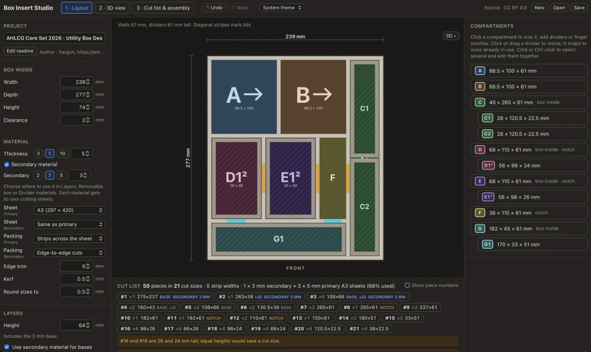

The 2nd page you can spin 3D model around to check if it really looks like how you pictured it. What would usually happen here is once you see the height or how close or narrow each compartments are, you realize your hand can't work with it and need to go back to revise the design.

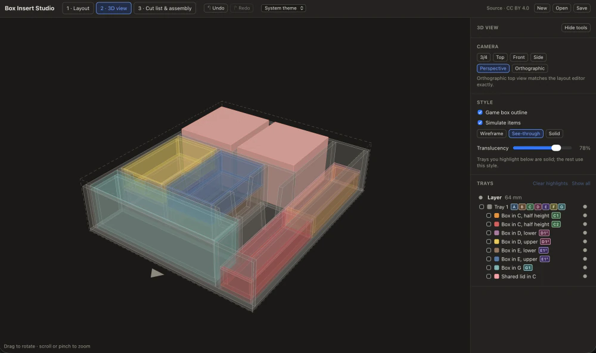

Check out the final 3rd page for packing simulation of individual pieces and so you know how many sheets of materials you need to buy, along with cutting and assembling instructions.

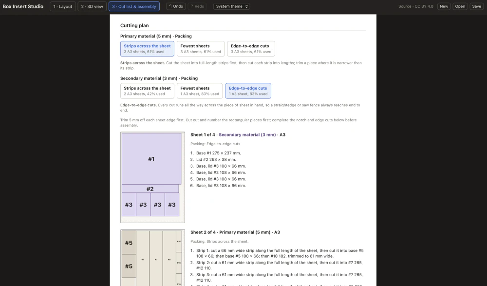

## How to use it

https://5argon.github.io/box-insert-studio/

Currently there is no detailed manual yet, please figure out on your own by messing with it. Progress is automatically saved in the browser and it survives refreshing without saving. In addition, you can use Save / Open to download / upload `.json` file in your computer of your box design.

There are sample designs to download in the `examples` folder. Download a JSON file, then choose **Open** in the app to load it.

- [Arkham Horror: The Card Game, Core Set 2026 : Utility Box Design with Stand Storage](examples/ahlcg-core-set-2026-utility-box-design-with-stand-storage.insert.json)
- Arkham Horror: The Card Game, Small Campaign Expansion box
  - [Design A](examples/ahlcg-small-campaign-expansion-design-a.insert.json): two horizontal card rows instead of the original centered column.
  - [Design B](examples/ahlcg-small-campaign-expansion-design-b.insert.json): the vertical column moved to the left, with two small side slots for shared encounter sets.
  - [Design C](examples/ahlcg-small-campaign-expansion-design-c.insert.json): Design B with the long column divided for the scenarios, plus a modular 8 cm slot for Core 2026 encounter sets.

## Demo

To ensure that the calculations are correct and assembly instruction make sense (for a vibe coded app to not be 'AI slop'), I've tested assembling the "Design C" above for real with 5 mm foam board as the material. Everything checks out and I'm quite happy I was able to turn my brain off and just cut and glue as it said.

  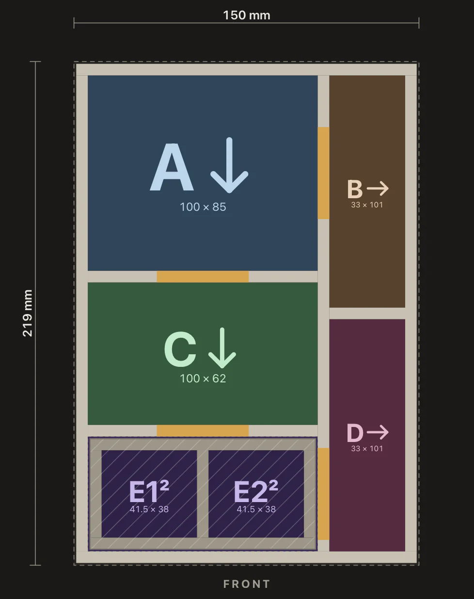
  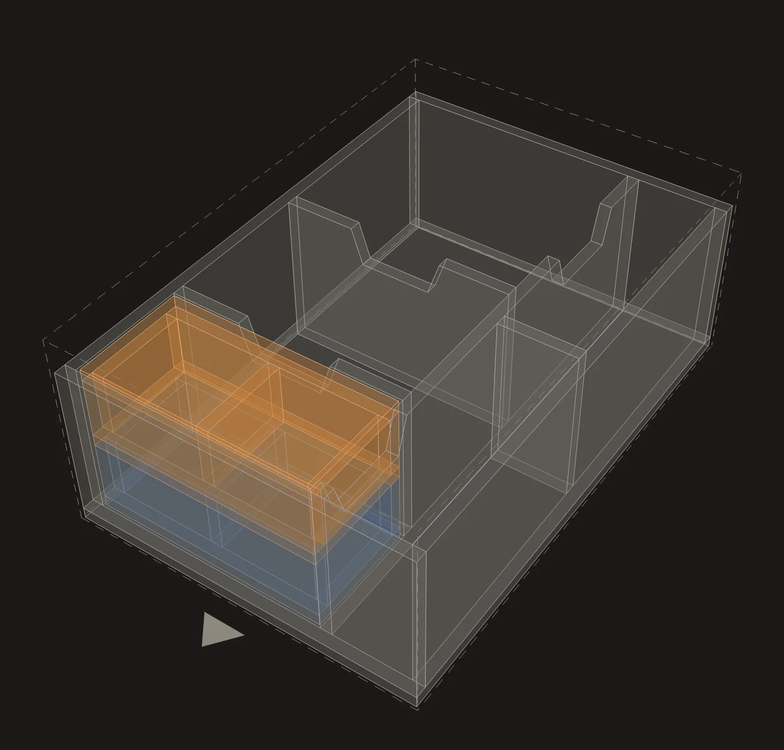

  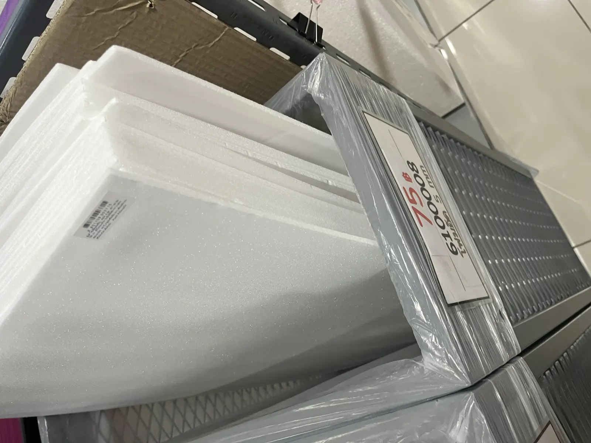
  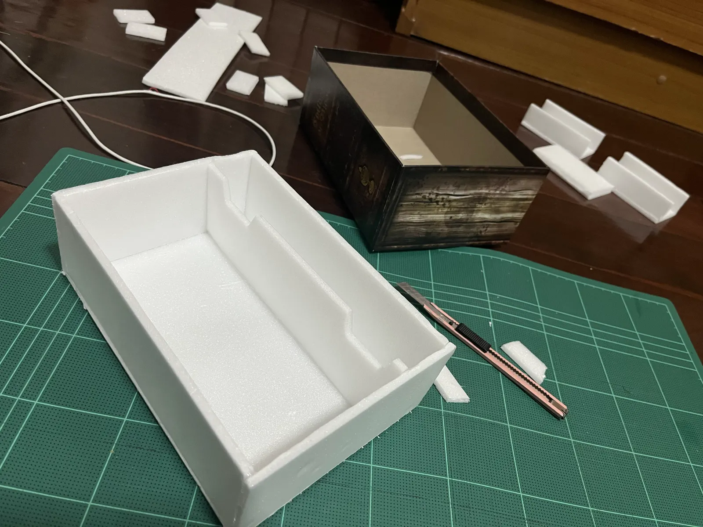
  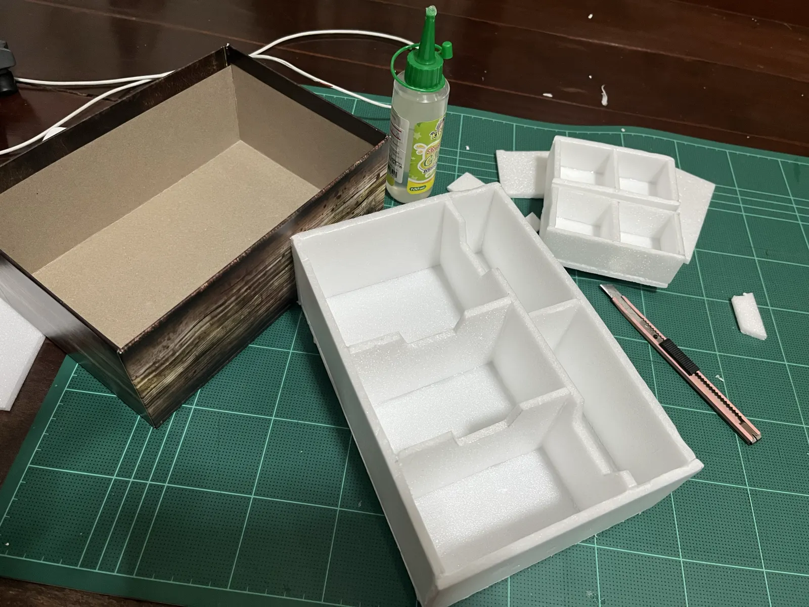
  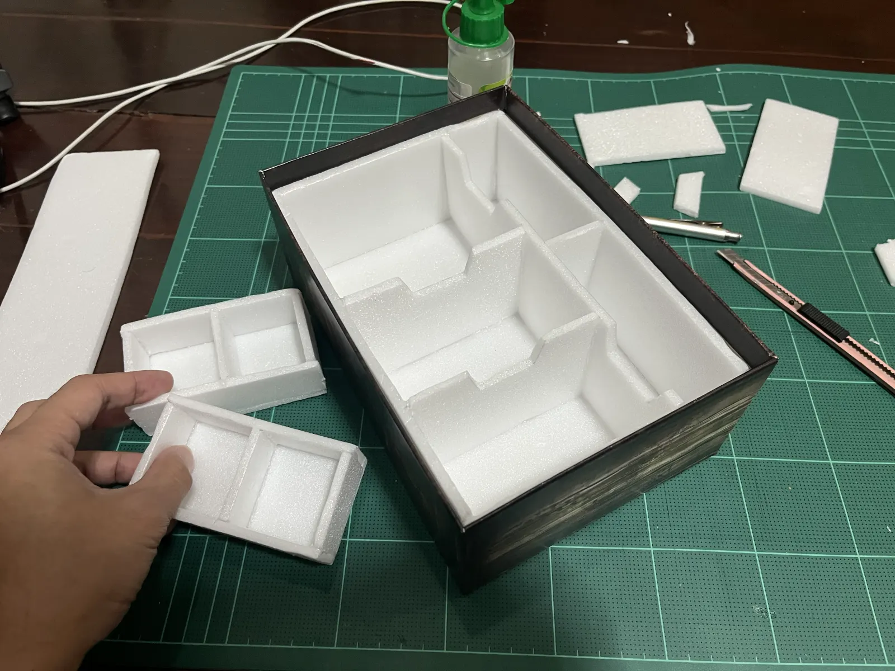
  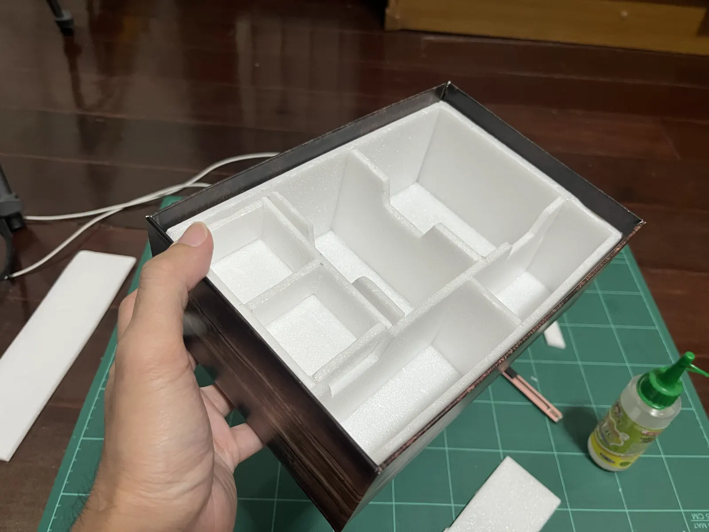
  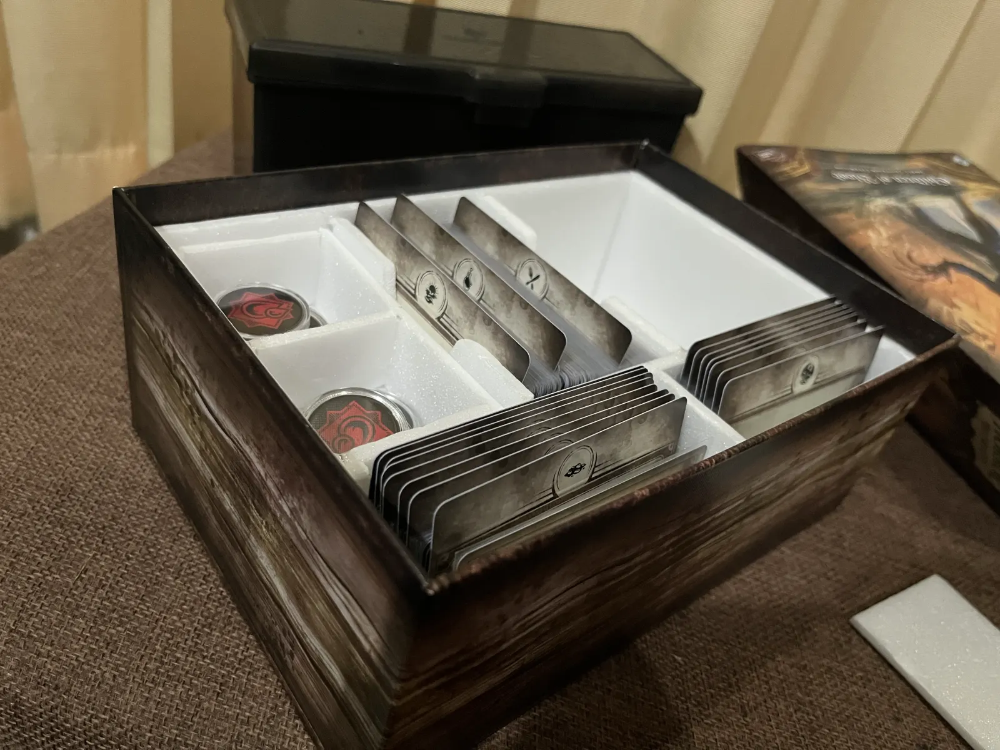

Though I still take no responsibility if any bug loses you money, this should be quite reassuring?

## Motivations

- Trial and Error : It is hard to estimate whether everything fits or not until everything is in place. I want a playable UI that allow quick experimenting and discovery of new ideas / pivots of design.
- Material Thickness : You wanted to design in terms of compartment size, but you don't want to think about adding up material's thickness whether that ended up mathematically checked out within the inside dimension of the box or not.
  - This is not just horizontally, it also affects vertical space as well. You wanted to know how much headroom you have left for game manuals after everything stacked. When a removable box is added (a box inside a compartment), it doubles up the thickness and you often wanted to know the effective height of that box as well. (e.g. Could your hand reach the bottom of it?) More problem if you decided to stack 2 removable boxes.
- Clearance : The outermost tray cannot be exactly fitting the inner dimension of the box as it would be too tight. Whether you'll allow 0.5 mm or 1 mm of clearance from each side, you want this accounted in the calculation automatically. A removable box will also need this clearance once again, and so do separate trays next to each other.
- Item Simulation : See how many items of the same shape you could fit in a row along a given item direction, for compartment of cards or coins.
- 3D Preview : Very useful to quickly spot physical UX problems no tools can report, such as hand reachability to grab stuff. Realizing the problem after you buy and cut up the materials seems to be number one source of money waste.
- Maximize Shared Cut Sizes : Tool actively suggests you snap to a certain number to produce as many same dimension cut as possible in the cutting plan.
- Assembly Steps : With some limitations baked in, it is possible to produce formulatic step by step assembly instructions like Ikea furnitures. This would tell you how many sheet of the material you should prepare upfront. You can also choose between different packing (Strips across the sheet, Edge-to-edge cuts or Fewest sheets) whether you are looking for least amount of sheets or easier time cutting them. The longest cuts run along the sheet's short edge by default, so a ruler shorter than the sheet still reaches them; choose the long edge for fewer, longer cuts.

## Feature Overview

- Use a thinner secondary material for the bases (the bottom piece of each tray) to increase headroom. The secondary material can also be used for lids, bases of removable boxes and individual dividers, and can have its own sheet size.
- Can choose between each layer being one glued tray of several compartments, or separate trays where every compartment is its own tray with the clearance between them.
- Mark a compartment's width or depth as Locked or Flex, whether it will receive changes when other nearby compartment changes in size or not.
- Add a removable box to a compartment, an another smaller box inside that could be pulled out. If this is too deep to pick up, you can stack two boxes of half the height instead, or leave out the top one. This box can still be divided as normal, and can have a lid.
- Mark any side of a compartment (the wall or divider there) as having a finger notch, or as a lowered side. (Otherwise walls and dividers are flushed on the top.)
- Item simulation of either box or cylinder shape to see how many would fit in a row, leaving the free space you want. The item direction arrow sets which way they face; items fill from the arrow's tail toward its head.
- Specify global clearance value that get used at the edge of the box, between separate trays, and around removable boxes.
- Cut list of the pieces, and a cutting plan of the sheets of material you have to buy given a sheet size.
- Sheet size, packing, edge trim and kerf are set on the Cut list & assembly page and remembered in your browser instead of saved in the design file, as they depend on the material you can get. Opening a design from someone else keeps your own sheet settings.
- Can cut all removable boxes from sheets of their own in the cutting plan, not mixed with the other pieces, in case you want to make them from a different kind of material of the same thickness. Those sheets can have their own sheet size.
- 3D view can quickly screams UX issues of your finished box.
- Step by step cutting and assembling instructions. You can save this instruction as PDF or download cut list as CSV.
- Save and load JSON file to your computer to keep or share your design.
- Download OBJ models: the whole insert, plus one file per tray and removable box.

## Can't do

- Slanted divider
- Removable box inside removable box (you really want that?)

## Development

To run the app on your own machine or continue developing it, see [development.md](development.md).
